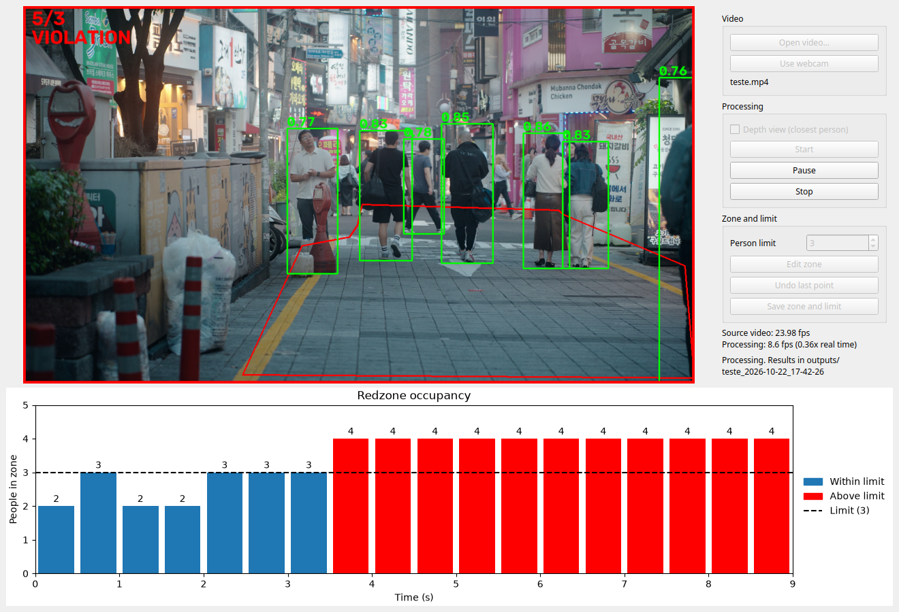
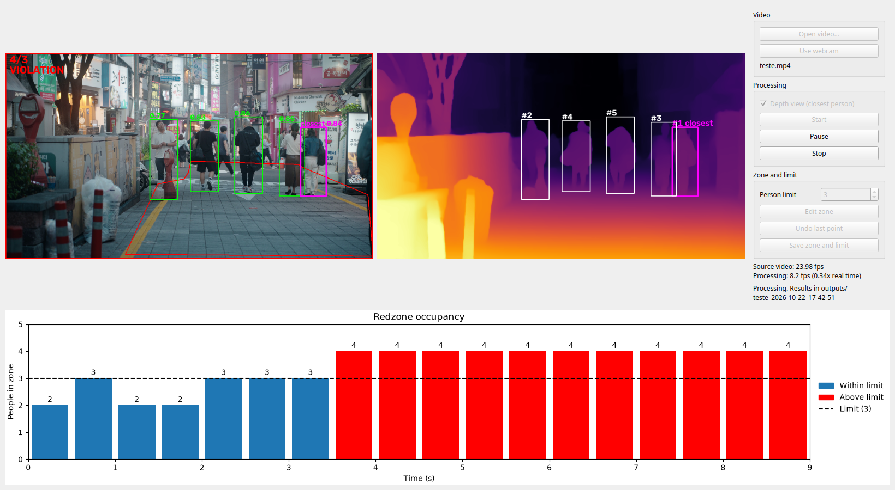
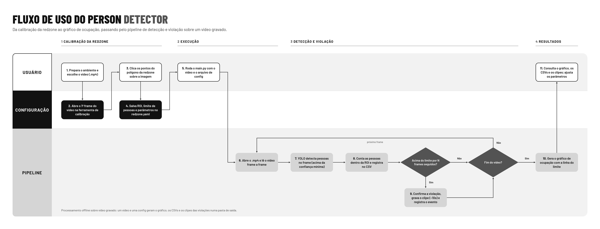
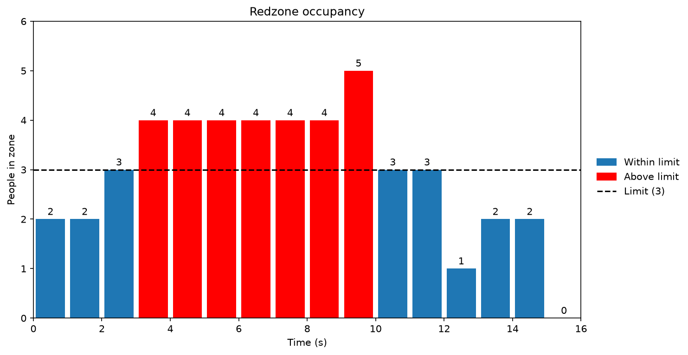

# Person Detector

> **Person Detector** is a computer vision pipeline that counts people inside a user-defined red zone of a recorded video or a live webcam, turns noisy per-frame counts into stable violation events, saves every violation as a clip with the detections drawn on it, and can show who is the closest person to the camera.

<div align="left">

[](LICENSE)
[]()
[]()
[]()

</div>

<details>
<summary><strong>Table of Contents</strong></summary>

- [About](#about)
- [Demo](#demo)
- [Features](#features)
- [Tech Stack](#tech-stack)
- [Architecture & Design Decisions](#architecture--design-decisions)
- [Getting Started](#getting-started)
- [Usage](#usage)
- [Commands](#commands)
- [Configuration](#configuration)
- [Output Structure](#output-structure)
- [Development](#development)
- [Performance & Troubleshooting](#performance--troubleshooting)
- [License](#license)
- [Author](#author)

</details>

---

## About

Counting people in a video is easy; deciding when a zone is *actually* over its limit is not. A detector flickers: it misses someone for a frame or sees a ghost for one, so a naive "count above the limit" check fires dozens of false alerts on a single event. This project puts a debounce state machine between the detector and the alerts, counts a person only when enough of their box is inside the zone (a percentage you set in the config), and keeps a rolling buffer so each clip shows what happened *before* the alert, not just after. Everything runs on the CPU, with no GPU required.

---

## Demo

```bash
poetry run python main.py --video videos/teste.mp4
```

```
frame 0: 2 people in zone
frame 50: 3 people in zone
frame 100: 4 people in zone
frame 150: 4 people in zone
frame 200: 4 people in zone
frame 250: 4 people in zone
frame 300: 2 people in zone
frame 350: 2 people in zone
Processed 361 frames in 24.4 s (14.8 fps)
```

```
outputs/teste_2026-10-22_17-40-37/
├── charts/occupancy.png
├── clips/violation_001.mp4
├── csv/events.csv
└── csv/series.csv
```

That output comes from the sample video with a zone drawn for it and a limit of 3. The zone is saved in the config, so draw your own first (see [Usage](#usage)) before expecting the same numbers.

The same pipeline in the desktop window: live video with detections, a live occupancy chart, and a side panel to pick the source, draw the zone and set the limit. Here a violation is in progress (4 people in a zone limited to 3).



With **Depth view** on, a second panel shows a depth map next to the video. Everyone is ranked by how close they are to the camera, and the closest person is highlighted in magenta in both panels.



---

## Features

| Capability | Description |
|---|---|
| **Video or webcam** | Pick a video file from your computer inside the window, or detect live from the webcam. Times, chart and clips follow the real clock, so a slow machine does not distort them |
| **Zone-based counting** | A person counts when at least `counting.min_overlap_percent` of their bounding box area is inside the zone polygon (default 30%) |
| **Debounce** | A violation starts after N consecutive frames above the limit, ends after M consecutive frames at or below it, with a cooldown between events |
| **Closest person** | Optional second panel with a depth map. It ranks everyone by closeness (#1 is the closest) and highlights the closest person in both views. The highlight only moves after the change holds for a few frames |
| **Clips with context** | Each violation is saved with seconds of video from before the event (circular buffer) and after it, with the overlay drawn on. Encoding runs in a background thread, so a clip never stalls the processing |
| **Logs** | `series.csv` with the count of every frame and `events.csv` with the start, end, peak and clip of every violation |
| **Occupancy chart** | Bars with time on the horizontal axis and people on the vertical one, red above the limit, with the limit line. In the window it refreshes once per second of video |
| **Desktop window** | Live video, live chart, depth view and a zone and limit editor in a single screen (PySide6). It has Start, Pause and Stop, and the image refits whenever the window or a panel changes size |
| **Speed readout** | The window shows the fps of the source video and the real processing speed (current and average, also as a multiple of real time); the CLI prints the average at the end |
| **Calibration** | Draw the zone by clicking on a frame, from the window or from the command line |
| **Configurable** | Model, confidence, zone, counting rule, limit, debounce, clip length and depth settings live in one YAML file |
| **CPU only** | Runs with the CPU build of PyTorch |

---

## Tech Stack

| Tool | Purpose |
|---|---|
| [Python](https://python.org) 3.12 | Core language |
| [Ultralytics YOLO](https://docs.ultralytics.com) | Person detection |
| [PyTorch](https://pytorch.org) (CPU build) | Inference backend |
| [Transformers](https://huggingface.co/docs/transformers) and [Depth Anything V2](https://huggingface.co/depth-anything/Depth-Anything-V2-Small-hf) (Small) | Depth estimation for the closest-person view |
| [OpenCV](https://opencv.org) | Video reading, drawing, clip writing |
| [PySide6](https://doc.qt.io/qtforpython-6/) | Desktop window |
| [Matplotlib](https://matplotlib.org) | Occupancy chart (PNG and live) |
| [NumPy](https://numpy.org) | Array operations |
| [PyYAML](https://pyyaml.org) | Configuration file |
| [Poetry](https://python-poetry.org) | Dependency and environment management |
| [pytest](https://pytest.org) and [Ruff](https://docs.astral.sh/ruff/) | Tests, linting and formatting |

---

## Architecture & Design Decisions



```
.
├── main.py                     CLI entry point
├── gui.py                      desktop window entry point
├── calibrate.py                command-line zone calibration
├── config/
│   └── config.yaml
├── src/
│   ├── pipeline.py             per-frame processing, shared by the CLI and the window
│   ├── person_detector.py      YOLO wrapper
│   ├── video_reader.py         video files and live cameras
│   ├── redzone.py              zone polygon and box-overlap counting
│   ├── violation.py            debounce state machine
│   ├── clip_recorder.py        time-based circular buffer, clips written in a thread
│   ├── depth_estimator.py      depth model wrapper and input preparation
│   ├── depth_runner.py         depth estimation in a background thread
│   ├── depth_view.py           people ranking by depth and the depth panel drawing
│   ├── closest_tracker.py      keeps the closest person steady across frames
│   ├── metrics_logger.py       CSV logging
│   ├── overlay.py              drawing on frames
│   ├── chart.py                occupancy chart
│   ├── config_loader.py        YAML loading and saving
│   ├── run_dir.py              output folder naming
│   ├── errors/                 project exceptions
│   ├── enums/                  shared enums
│   └── gui/                    window, worker thread, live chart, video label, fps meter
├── scripts/
│   └── tune_parameters.py      offline study of confidence and debounce
├── tests/
├── docs/                       README assets
└── diagram/                    usage flow
```

**Why this shape:** the frame is reduced once, on entry, so detection, drawing, the clip buffer and the window all work at 1280 pixels wide instead of repeating 4K operations. `Pipeline.process` handles exactly one frame and returns the result, so the CLI loop and the window's worker thread share the same logic instead of duplicating it. The debounce lives in its own class that only sees integer counts, which makes it testable with made-up sequences and no model. No class reads the YAML on its own: the entry points load the config and hand plain values down, so everything can be tested without files. Errors derive from one base exception, so the entry points catch every expected failure in a single `except` and let real bugs surface with a full traceback. Counting uses the share of the box inside the zone instead of a single point, so a person half in and half out is not decided by one pixel. The default is a low 30% on purpose: the zone is drawn on the ground, so for someone standing inside it, only the lower part of their box overlaps it. Raise it to be stricter, lower it to count anyone touching the zone.

Every frame carries its own time. For a file it is `frame / fps`; for a webcam it is measured on the clock, because processing is slower than the camera. The CSVs, the chart and the clips all use that time, and the clip recorder keeps *seconds* of video instead of a number of frames, so a clip made from a slow stream still plays at the speed it was recorded. Clips are encoded in a background thread, which removes the stall that dumping the pre-event buffer used to cause.

The depth model runs in its own thread on every few frames, on a copy of the clean frame, so detection never waits for it. Detections carry no identity, so the closest person is followed from frame to frame by the overlap of their boxes, and the highlight only moves after another person stays the closest for several frames in a row.

**Known limitations:**
- YOLO on a CPU is the bottleneck: expect around 10 fps on a modest laptop and a few on 4K video, not real time. The depth panel shares the same cores, so the total fps drops a little with it on.
- The depth is relative: it compares people inside one frame and is not a distance in meters. It is updated every few frames, so the closest person can lag a little behind quick movements.
- The webcam is always camera 0, and its image can lag slightly behind reality while the model is busy.
- The zone is stored in pixels of the source, so it has to be redrawn for a source with another resolution.
- A single zone polygon per configuration.
- Clips are written with the `mp4v` codec, because that is what the pip build of OpenCV can encode; some viewers cannot play it.
- Only the top-level keys of the config (and `counting.min_overlap_percent`) are validated, so a missing nested key surfaces as a `KeyError`.
- The default parameters were checked against a single 15-second video.
- Developed and tested on Linux only.

---

## Getting Started

### Prerequisites

- Linux (developed on Ubuntu with GNOME and Wayland)
- Python 3.12
- [Poetry](https://python-poetry.org/)

No GPU is needed: the project installs the CPU build of PyTorch from the official PyTorch index.

### Installation

```bash
git clone https://github.com/Hugolelis/person_detector-ai.git
cd person_detector-ai
poetry env use python3.12
poetry install
```

The first run downloads the YOLO weights (`yolov8n.pt`, about 6 MB) into the project folder. They are git-ignored. The first time you switch the depth view on, the depth model (about 100 MB) is downloaded from Hugging Face into `~/.cache/huggingface`.

### Environment Variables

The project does not use environment variables. Everything is configured in `config/config.yaml`.

### Running locally

```bash
poetry run python gui.py
```

Use **Open video...** in the window to pick a file, or pass `--video videos/your_video.mp4` to open one directly.

---

## Usage

### 1. Define the zone and the limit

Draw the zone on the first frame of your video, either in the window (**Edit zone**, then **Save zone and limit**) or from the terminal:

```bash
poetry run python calibrate.py --video videos/your_video.mp4
```

Left click adds a point, right click or `u` undoes the last one, `Enter` confirms and `Esc` cancels. The tool then asks for the person limit and writes everything to `config/config.yaml`.

### 2. Process a video from the command line

```bash
poetry run python main.py --video videos/your_video.mp4
```

### 3. Or process it in the window

```bash
poetry run python gui.py
```

Click **Open video...** and pick a file from your computer (`--video PATH` opens one directly), or click **Use webcam** to detect live from camera 0. The source can be changed between runs, not while it is processing. Then press **Start**.

The video plays with the detections and the chart grows below it. **Pause** freezes and resumes the processing, and **Stop** ends the run early. When the video ends, the window goes back to the first frame with an empty chart, ready for another run, and the results stay in the folder shown in the side panel. The side panel also shows the fps of the source video and how fast it is actually being processed, in frames per second and as a multiple of real time. While **Edit zone** is active, left click on the video adds a point and right click removes the last one.

**Depth view.** Tick *Depth view (closest person)* before **Start** to open a second panel next to the video. A depth model estimates, for each pixel, how near it is to the camera. Each person is ranked by the typical depth of the lower, central part of their box, and the closest one is drawn in magenta in both panels. The highlight only moves to someone else after they stay the closest for a few frames in a row, so it does not flicker. The depth is relative (it compares people within the same frame, it is not in meters) and it is estimated in the background every few frames, so it never slows the detection down.

**Webcam.** The run has no end: press **Stop** when you are done. Times in the CSVs, the chart and the clips follow the real clock, so they stay correct even when processing is slower than the camera. Draw the zone again for the webcam (**Edit zone**), because the zone is stored in pixels of the source and the camera usually has another resolution.

---

## Commands

| Command | Description |
|---|---|
| `python main.py --video PATH` | Process a video and write clips, CSVs and the chart. Optional: `--config` (default `config/config.yaml`), `--output` (default `outputs`) |
| `python gui.py` | Open the window with live video, live chart and the zone editor. Optional: `--video` (otherwise pick the file in the window), `--config`, `--output` |
| `python calibrate.py --video PATH` | Draw the zone on the first frame and save it, asking for the limit. Optional: `--config` |
| `python -m scripts.tune_parameters --video PATH` | Evaluate confidence thresholds and debounce settings offline |

---

## Configuration

`config/config.yaml`:

| Key | Meaning |
|---|---|
| `detection.model` | YOLO weights (`yolov8n.pt` is the small, CPU-friendly one) |
| `detection.confidence_threshold` | Minimum confidence to keep a detection |
| `detection.threads` | PyTorch CPU threads. Use about the number of physical cores |
| `detection.stride` | *Optional.* Run YOLO every N frames and reuse the last boxes in between (default `1`). Counting and debounce still run on every frame |
| `processing.width` | *Optional.* Frames wider than this are reduced once, on entry (default `1280`), and everything after runs at that size. `roi` stays in original-frame pixels and is scaled automatically. `0` keeps the original size |
| `roi` | Zone polygon, a list of `[x, y]` points in the pixels of the original frame |
| `depth.enabled` | *Optional.* Start with the depth view on. The window has a checkbox for it too, and the checkbox choice is never written to the file |
| `depth.model` | *Optional.* Hugging Face depth model (default `depth-anything/Depth-Anything-V2-Small-hf`) |
| `depth.stride` | *Optional.* Estimate depth on every N-th frame (default `10`) and reuse the last map in between |
| `depth.closest_confirm_frames` | *Optional.* Frames in a row another person must be the closest before the highlight moves to them (default `5`). `1` switches at once |
| `depth.input_size` | *Optional.* Short side of the image given to the depth model, a multiple of 14 (default `266`). Larger is more detailed and slower |
| `counting.min_overlap_percent` | *Optional.* Percentage (0 to 100) of a person's box that must be inside the zone to count them (default `30`). `0` counts anyone touching the zone, `100` only people fully inside |
| `person_limit` | A violation needs a count strictly **above** this value |
| `violation.frames_to_confirm_start` | Consecutive frames above the limit to start a violation |
| `violation.frames_to_confirm_end` | Consecutive frames at or below the limit to end it |
| `violation.cooldown_frames` | Frames ignored after a violation ends |
| `clip.seconds_before` / `clip.seconds_after` | Context kept around a violation |

---

## Output Structure

Each run writes to its own folder, so nothing is overwritten:

```
outputs/
└── your_video_2026-10-22_08-04-33/
    ├── clips/violation_001.mp4     one clip per violation, with the overlay drawn
    ├── csv/series.csv              frame, timestamp, count, in_violation
    ├── csv/events.csv              start and end (frame and time), peak count, clip path
    └── charts/occupancy.png        occupancy over time
```

A run on the webcam goes to `webcam_<date>` instead.



In the chart, each bar is the median count over a time interval (0.5 s for short videos, growing with the duration so there are about 30 bars at most). Bars above the limit are red, and the dashed line marks the limit.

---

## Development

```bash
poetry run pytest          # tests
poetry run ruff check .    # lint
poetry run ruff format .   # format
```

The tests cover what does not need a model: zone counting by box overlap, the debounce state machine, the chart bars and axes, the clip recorder and its background thread, config validation, the pipeline using a fake detector, a fake camera and fake depth maps (people ranking, the closest-person confirmation and the depth thread), and the window itself, driven without a screen with a generated video (picking a source, zone editing, start, pause, stop, finish, resizing and close).

`scripts/tune_parameters.py` runs the detector once, caches the result, and evaluates confidence thresholds and debounce settings offline. A larger model runs on a sample of frames and serves as the reference for the count error.

---

## Performance & Troubleshooting

**The video is slow.** YOLO on a CPU is the bottleneck, and a few settings matter a lot:
- Set the OS power mode to **Performance** (`powerprofilesctl set performance`). In power-saver mode the CPU can stay near a third of its maximum speed.
- Keep `detection.threads` close to the number of **physical** cores. Using every logical core while other programs run can make inference several times slower.
- Use `detection.stride: 3` (or similar) for a smoother window, at the cost of boxes that lag a couple of frames behind.
- Close heavy applications, such as browsers, while processing.

**The window crashes with `GLib-GIO-ERROR ... does not contain a key named 'antialiasing'`.** This happens when launching from the terminal of a **snap-installed VS Code**: the snap sets `GSETTINGS_SCHEMA_DIR` and `XDG_DATA_DIRS` to its own folders, and GTK then reads an outdated schema. Run from a regular terminal, or restore the original values for the command:

```bash
env -u GSETTINGS_SCHEMA_DIR XDG_DATA_DIRS="$XDG_DATA_DIRS_VSCODE_SNAP_ORIG" \
    poetry run python gui.py --video videos/your_video.mp4
```

To fix it for the VS Code terminal permanently, add this to the VS Code user settings:

```json
"terminal.integrated.env.linux": {
    "GSETTINGS_SCHEMA_DIR": null,
    "XDG_DATA_DIRS": "/usr/local/share/:/usr/share/"
}
```

**Qt prints warnings about fonts or Wayland.** The lines mentioning `QFontDatabase`, `propagateSizeHints` or `textinput` are harmless.

**A clip does not play in the browser or in the file preview.** It uses the `mp4v` codec. Open it with VLC, or convert it: `ffmpeg -i clip.mp4 -c:v libx264 -pix_fmt yuv420p clip_h264.mp4`.

**`Could not open camera 0`.** No camera was found at index 0, another program is using it, or the user has no permission to read `/dev/video0` (on Linux, being in the `video` group is usually required).

**`The depth view needs the 'transformers' package`.** Run `poetry install` (or `poetry add transformers`) to install the dependency of the depth view.

**The zone is in the wrong place after changing the source.** The zone is saved in pixels of the video it was drawn on. Use **Edit zone** to draw it again for the new source and save it.

**`Could not open video file`.** The path is wrong, or the format is not supported by the FFmpeg backend of OpenCV.

---

## License

Distributed under the **MIT License**.

---

## Author

[Hugolelis](https://github.com/Hugolelis)
